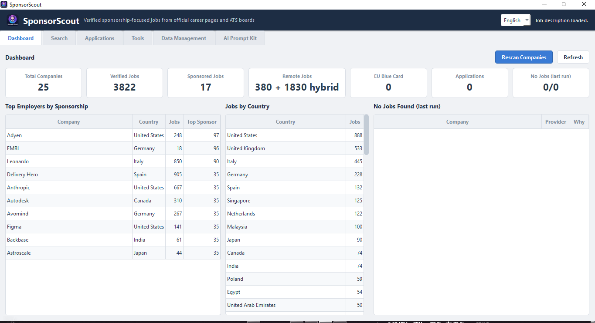
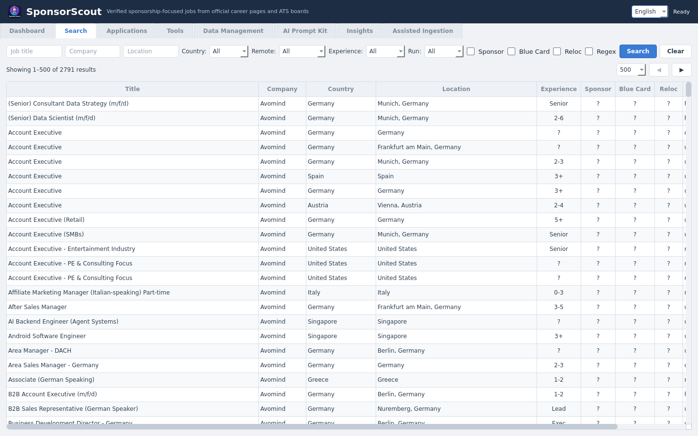
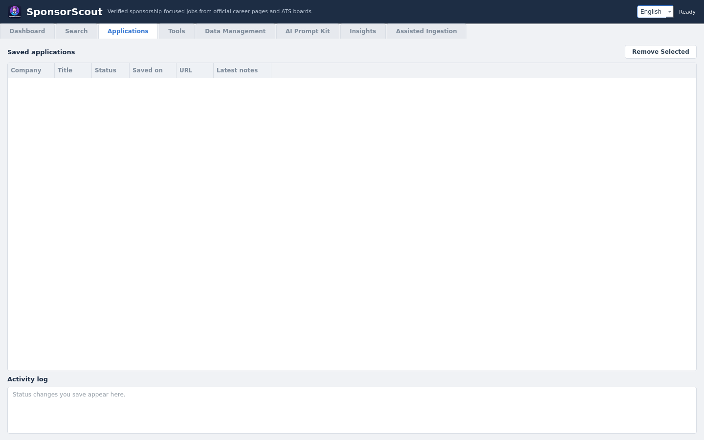
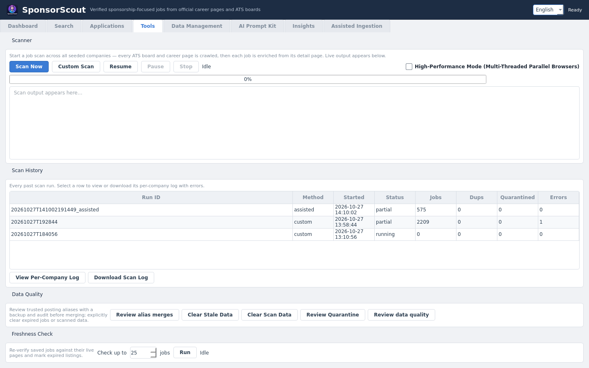
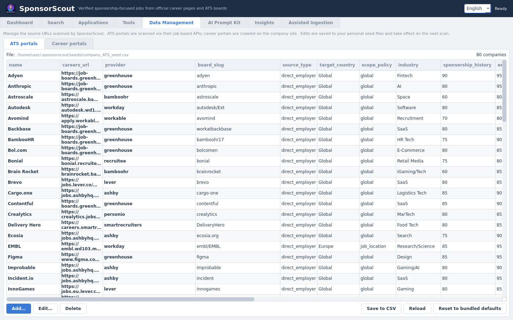
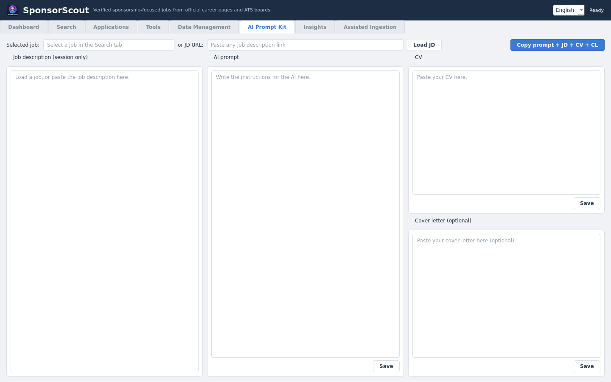
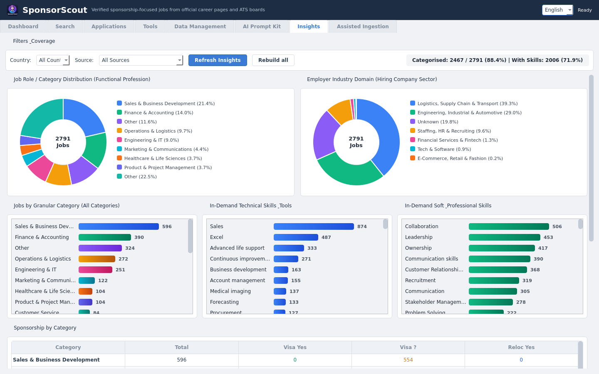
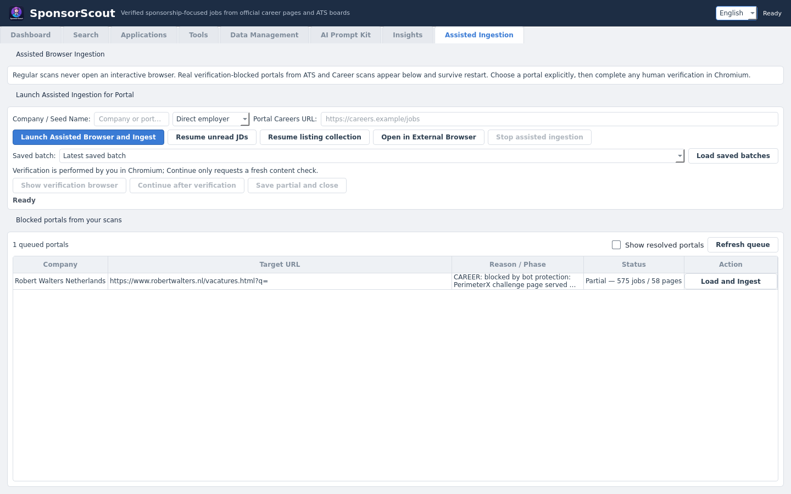
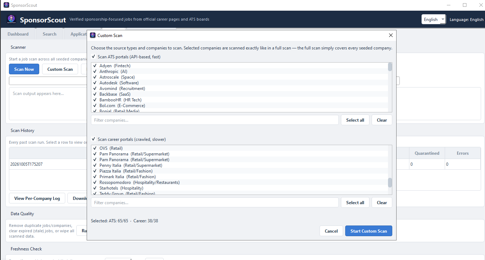

# SponsorScout

[🇬🇧 English](#-english) · [🇮🇹 Italiano](#-italiano)

Find jobs that actually sponsor visas — scanned from official sources, stored
on your own computer.

> **Start here:** [📸 Screenshots / Schermate](#-screenshots) ·
> [🚀 Quick Start / Avvio Rapido](#-quick-start) ·
> [🗂 The Eight Tabs / Le Otto Schede](#-the-eight-tabs)



*The screenshots below are illustrative captures from the current eight-tab UI;
they use a local sample database and no cloud account.*

---


# 🇬🇧 English

## 📖 Contents

- **[📸 Screenshots](#-screenshots)** — see every tab before you install
- **[🚀 Quick Start](#-quick-start)** — install, scan, search in three steps
- **[🗂 The Eight Tabs](#-the-eight-tabs)** — the full workspace tour
- [Download](#-download)
- [What It Does](#-what-it-does)
- [Scanning](#-scanning)
- [Verification and Fix Register](#verification-and-fix-register)
- [Where Your Data Lives](#-where-your-data-lives)
- [Troubleshooting](#-troubleshooting)
- [Building From Source](#-building-from-source)
- [Requirements](#-requirements)
- [License](#-license)

---

## 📥 Download

Installers are on the [GitHub Releases page](https://github.com/Kazehaya395/SponsorScout/releases):

| Platform | File |
|----------|------|
| Windows 10 / 11 | `sponsorscout-<version>-setup.exe` |
| Linux (Debian / Ubuntu / Mint) | `sponsorscout_<version>_<arch>.deb` |
| Linux (Fedora / RHEL / openSUSE) | `sponsorscout-<version>-1.<arch>.rpm` |

`<arch>` is your machine's architecture (`amd64` on most desktops, `arm64` on
Raspberry Pi / Graviton). Pick the file for your platform. The app and its
browser are bundled, so no Python is needed.

Installing the Linux packages:

```bash
# Debian / Ubuntu / Mint
sudo apt install ./sponsorscout_<version>_<arch>.deb

# Fedora / RHEL / openSUSE
sudo dnf install ./sponsorscout-<version>-1.<arch>.rpm   # or: sudo zypper install ...
```

Both packages install to `/opt/sponsorscout` and add a launcher plus a desktop
entry; the bundled Chromium is used automatically.

---

## 📸 Screenshots

> **See the whole workspace at a glance.** These are current captures of all
> eight tabs. Click any image to open the full-size version.

<table>
  <tr>
    <td align="center"><strong>1 · Dashboard</strong><br><a href="assets/main_dashboard.png"></a></td>
    <td align="center"><strong>2 · Search</strong><br><a href="assets/job_search_table.png"></a></td>
  </tr>
  <tr>
    <td align="center"><strong>3 · Applications</strong><br><a href="assets/applications_dashboard.png"></a></td>
    <td align="center"><strong>4 · Tools</strong><br><a href="assets/scanning_tool.png"></a></td>
  </tr>
  <tr>
    <td align="center"><strong>5 · Data Management</strong><br><a href="assets/backend_data_management.png"></a></td>
    <td align="center"><strong>6 · AI Prompt Kit</strong><br><a href="assets/AI_tailoring_setup.png"></a></td>
  </tr>
  <tr>
    <td align="center"><strong>7 · Insights</strong><br><a href="assets/insights_dashboard.png"></a></td>
    <td align="center"><strong>8 · Assisted Ingestion</strong><br><a href="assets/assisted_ingestion.png"></a></td>
  </tr>
</table>

**Bonus — Custom Scan:** choose source types and companies before a targeted run.

<a href="assets/custom_portal_selection.png"></a>

---

## ✨ What It Does

- **Scans official sources only** — 8 ATS job boards (Ashby, Greenhouse,
  Lever, SmartRecruiters, Personio, Recruitee, Workable, Workday) through their
  public APIs, plus company career pages with a headless browser when needed.
- **Classifies every job** — sponsorship, relocation support, remote type and
  EU Blue Card eligibility, detected from the job description.
- **Extracts the experience requirement** — the exact figure the ad states
  (`4+`, `3-5 years`, `6 months`), or the seniority level (`Senior`), read in
  English, German, Italian, Dutch, French, Spanish and Portuguese.
- **Keeps everything local** — one SQLite file on your computer. Nothing is
  uploaded.
- **Tracks applications** — Saved → Applied → Interview → Offer → Rejected.
- **Two languages** — English and Italian, switchable at any time.

---

## 🚀 Quick Start

> **New here?** Follow these steps. The first scan is the only slow part.

1. **Install** — download the Windows or Linux package from
   [Download](#-download) and launch SponsorScout. No Python is needed for the
   installer.
2. **Run the first scan** — accept the first-run prompt, or press **Scan Now**
   in **Tools**. A full scan can take minutes to hours depending on how many
   companies are enabled. You can pause, stop and resume without losing the jobs
   already found.
3. **Find and track jobs** — open **Search** to filter by country, title, visa
   sponsorship, EU Blue Card, remote type and regex; save interesting jobs to
   **Applications**.
4. **Go deeper** — open **Insights** for category, skill, domain and
   sponsorship charts, **AI Prompt Kit** to assemble an application prompt, and
   **Assisted Ingestion** only for portals that require human verification.

Running from source? See [Building From Source](#-building-from-source).

---

## 🗂 The Eight Tabs

> The app is organised as eight tabs. Use this map first, then read the short
> description and full-size screenshot for each one.

| # | Tab | Use it for | Screenshot |
|---|-----|------------|------------|
| 1 | [Dashboard](#1-dashboard) | KPIs, top employers by sponsor score, jobs by country | [View](assets/main_dashboard.png) |
| 2 | [Search](#2-search) | Filter, open and save every scanned vacancy | [View](assets/job_search_table.png) |
| 3 | [Applications](#3-applications) | Track Saved → Applied → Interview → Offer → Rejected | [View](assets/applications_dashboard.png) |
| 4 | [Tools](#4-tools) | Run scans, inspect history, check data quality | [View](assets/scanning_tool.png) |
| 5 | [Data Management](#5-data-management) | Edit ATS and career seed files | [View](assets/backend_data_management.png) |
| 6 | [AI Prompt Kit](#6-ai-prompt-kit) | Build one copy-ready prompt + JD + CV + CL message | [View](assets/AI_tailoring_setup.png) |
| 7 | [Insights](#7-insights) | Explore category, skill, domain and sponsorship charts | [View](assets/insights_dashboard.png) |
| 8 | [Assisted Ingestion](#8-assisted-ingestion) | Resolve bot-blocked portals and ingest jobs directly | [View](assets/assisted_ingestion.png) |

### 1. Dashboard
Company totals, explicit sponsorship / EU Blue Card counts, scan actions
(**Scan Now**, **Custom Scan**) and per-company rescan; the entry point for
every run. The employer table is ranked by **Max Sponsor Score**, not by a count
of sponsored jobs, and the zero cards have tooltips explaining that `Unknown`
is not `No`.


### 2. Search
Every scanned vacancy with filters (country, title, sponsorship tri-state,
Blue Card, remote type); open the original ad or send the job to the AI
Prompt Kit.


### 3. Applications
Per-job application tracking (status, dates, notes) stored locally.


### 4. Tools
Scan control and history: progress, **Scan History** with the per-run log set
(one merged jobs CSV plus quarantine, errors and scan log), seed shortcuts, diagnostics, and an optional
**High-Performance Mode** toggle for multi-threaded parallel browser pools on
capable PCs (>4 cores, >8 GB RAM).


### 5. Data Management
Edit the company lists that get scanned (**ATS portals** and **Career
portals**). Changes apply on the next scan; **Reset to bundled defaults**
restores the original lists.


### 6. AI Prompt Kit
Build one message for any AI chatbot: **Load JD** fills the job description
(or paste a link in **or JD URL**), then **Copy prompt + JD + CV + CL** copies
prompt, job description, CV and cover letter in full, in that order. Prompt,
CV and cover letter persist between sessions.


### 7. Insights
Aggregated visual market intelligence extracted from saved full job
descriptions in SQLite outside the scan loop: category & role and
employer-industry donut charts with click-to-cross-filter, in-demand technical
and soft skill frequency lists without arbitrary truncation, a
sponsorship-per-category table that keeps Yes / No / Unknown distinct. Every
chart is a control: clicking a donut slice **or a bar** filters the whole tab to
that category, employer domain or skill term, and clicking it again clears the
filter, so a skill bar answers "which jobs actually ask for Python". Reads are
answered from a version-stamped aggregate cube that the refresh pass rebuilds,
which is why a filtered repaint costs milliseconds instead of a table scan; a
filter the aggregate cannot answer (one run, or a source type) is computed live,
and a
**Refresh Insights** action (also triggered automatically in the background
after each scan or assisted harvest). It processes only new/changed inputs or
a changed packaged taxonomy, shows processed/total plus committed coverage,
and yields while regular or assisted ingestion is active. `Other` / `Unknown`
and no-skill outcomes count as completed. **Rebuild all** is an explicit,
confirmed full rebuild; **Cancel refresh** retains committed batches.


### 8. Assisted Ingestion
Dedicated interactive browser environment for bot-guarded portals
(Cloudflare, PerimeterX, Datadome, "Press & Hold"): launch an interactive
Chromium window for any careers portal, clear the human verification once,
and SponsorScout takes over — automatic pagination across all result pages
and direct database ingestion, recorded with the same run logs as a regular
scan (see [Scanning](#-scanning)).


---

## 🔍 Scanning

### Full scan
The default. **Scan Now** (or the Dashboard's **Rescan Companies**) scans every
seeded company, because a partial scan would silently hide jobs you did not ask
for.

### Custom scan
**Tools → Custom Scan** lets you choose:

- **Source types** — *ATS portals* (fast, API-based) and/or *Career portals*
  (slower, crawled with a browser).
- **Companies** — tick the ones you want; filter or bulk-select to move fast.

A custom scan runs the exact same pipeline as a full scan, so result quality is
identical — only the scope and duration change. Use it to re-scan companies you
just edited. Custom runs appear as `custom` in Scan History.


### What a scan does
1. **ATS boards** — companies with a known ATS are pulled through the official
   job-board API.
2. **Career pages** — every company is also crawled through its own career page,
   so career-page-only companies are never skipped. Long lists are read page by
   page, following "next page" and "show more" links. On the fast path a board
   is read to at most 12 pages (`SPONSORSCOUT_STATIC_MAX_PAGES`). If more pages
   remain, the retained rows are marked **partial**, not falsely complete;
   browser listing caps and repeat stops are reported the same way.
3. **Category-link check** — a link that leads to a department or category
   listing instead of a real job ad (its page shows more job links and no
   apply button) is detected and dropped, so only actual postings reach the
   database.
4. **Detail pages** — each job stays lightweight during scanning (extracting
   title, location, visa sponsorship / relocation / Blue Card evidence, and
   experience while saving the captured full JD text into SQLite for decoupled
   Insights extraction). Verdicts are only set from explicit evidence, and
   weaker sources never overwrite stronger ones.
5. **Anti-bot fast abort** — portals guarded by anti-bot challenges
   (Cloudflare, PerimeterX, DataDome, Imperva, Akamai, WAF 403/429, CAPTCHAs)
   are detected promptly without stalling the scan, logged as blocked portals
   for optional Assisted Ingestion, and skipped so remaining portals continue
   immediately.
6. Results are saved to the local database and appear immediately; Insights
   refreshes asynchronously from SQLite once the scan completes.

Progress shows live (`ATS 12/46`, `Career 88/162`). A company with no open
roles counts as done.

### Assisted ingestion and bot-guarded portals
**Normal and custom scans never open an interactive browser or start Assisted
Ingestion.** They collect real human-verification blocks from **both ATS and
Career**, continue other targets, and at completion show one notice directing
you to **Assisted Ingestion**. That tab automatically lists the deduplicated,
scoped URLs with source/phase/reason/status; the queue survives a restart.

**The queue lists listing-level walls, and only proven ones.** A portal is
queued when its **job listing** was refused: a confirmed vendor challenge page
(Cloudflare, Akamai, DataDome, PerimeterX, Imperva, "Press & Hold", …) or a
listing that provably produced nothing. It is **not** queued because a single job
description behind that listing could not be read, and a bare HTTP 401/403/429
with no challenge evidence is recorded as `listing access blocked: … (no
verification challenge observed)` rather than as bot protection. A listing whose
rows were already saved still says so in its reason
(`9 job row(s) were already saved from this listing`) when a real wall appeared
mid-pagination, and the unresolved-description count remains in the scan log's
Diagnostics as job-description coverage.
Re-crawling a listing that already saved 1,210 jobs only to re-read the same
descriptions was the cost this rule removes; in one 273-seed run it dropped the
queue from 20 portals to 11 while keeping every genuinely walled listing.
**Italiano:** la coda elenca solo i blocchi verificati della **lista** offerte,
non la singola scheda lavoro non letta; un 403 senza prova di challenge è
riportato come accesso bloccato, non come protezione anti-bot.

Only an explicit **Load and Ingest**, **Launch Assisted Browser and Ingest**,
**Resume unread JDs** or **Resume listing collection** opens Chromium. You
complete any human verification yourself. A fresh launch does not use a saved
batch merely because it is selected in the batch picker.
Only one assisted worker runs at a time; normal Scan/Custom/Resume and assisted
launch controls exclude each other. Choose **Direct employer** or **Recruiter /
agency** for a manual URL. Stop retains successful commits. A page cap, renewed
challenge or write failure is **partial**, never an unqualified success. An
interrupted old queue entry is retryable explicitly, not auto-resumed.

- **The board's own hrefs lead.** During ordinary traversal, pagination follows
  rendered links first, with existing bounded fallbacks. The starting state for
  **Resume listing collection** is never synthesised: it must already have been
  observed, retained and validated within the selected filter/hash scope.
- **A refused advance is not the end.** A paging step that re-serves the
  identical listing is retried with a different mechanism; only three refused
  advances on a *full* page may call it the end — and only after polite
  escalating cool-downs (15 s → 45 s → 90 s, at most three pauses per run) and
  up to four out-of-range probe loads per run.
- **Honest stop reasons.** Every stop names the last complete page and why:
  "no next-page control recognised on page N (last complete page M)", "board
  re-served the same listing after 3 paging attempts (last complete page M)",
  or "page cap reached". "Pages read" counts complete listing pages, never
  browser loads; retries stay visible as `loads`.
- **Live progress and genuine checks.** The tab shows the current page and
  ingested-job count. Passive security SDK scripts on a normal listing are
  not treated as bot walls. If a real challenge reappears mid-run, Chromium
  comes to the foreground and the status asks you to clear it; harvesting
  resumes after clearance, or reports an honest partial result if it expires.
- **Trusted pagination and complete descriptions.** Numbered/arrow controls
  use real Playwright pointer input, including SVG/localized next controls,
  and wait for AJAX cards to change. Already captured full JDs are reused;
  `Unknown` sponsorship is not a reason to fetch a JD again.
- **Politeness is never removed:** inter-load delays stay, and the cool-downs
  above are pure waiting. `max_pages` defaults to 500 per board (with
  1-indexed `data-page` self-click guards and sustained-progress probe/cooldown
  replenishment after 10 fresh pages). A local Chromium regression harvested
  602/602 jobs over 61 pages, including a re-served page and a human-cleared
  mid-run challenge. Live results still depend on the portal and clearance.

### Assisted launch configuration restoration — 25 October 2026

The previous working67-file build and the I7 ZIP were compared directly. I7 had
removed **two pre-existing Assisted launch/context values**: the existing
`--disable-blink-features=AutomationControlled` argument and the fixed Chrome126
user-agent override. At the user's direction, the exact previous launch/context
block is restored; no new browser, profile, user-agent value or launch flag is
invented. The existing bundled Chromium/fresh-context/CPU-only behavior remains.

This is a **targeted launch rollback**, not a full I7 rollback. I7 saved-batch
selection, observed-only listing continuation, controls, diagnostics and current
content/identity guards remain. In particular, I7's computed-DOM observations
are a separate retained difference; the source comparison alone does not prove
which factor caused the live verification failure. Installed-Chrome/profile
redesign was rejected and was not implemented; the working personal Chrome
profile/cookies are never touched. No database/CSV/history/country repair.

Current restoration verification: 1,140 passed / 3 unchanged disclosed baseline failures / 48 legacy skips / 0 collection errors (full suite, 28 October 2026), including the exact-old-launch regression. No new regression, no live CAPTCHA/Windows certification. Earlier I7
measurements below are historical for the pre-restoration build. No localhost
fixture certifies real CAPTCHA/provider acceptance or native Windows behavior.

**Italiano:** ripristinati esattamente i due valori precedenti di avvio/contesto
Assisted; nessun nuovo browser/profilo o valore inventato. Restano le funzioni I7
e i dati; non è un rollback completo né una garanzia di verifica sul sito vivo.

### Support detection after human verification
Assisted performs a bounded full-JD pass after listing traversal. It reads the
primary JobPosting/provider description or a semantic job container, not an
unresolved wall, recommended posting or recruiter/HQ marketing. It uses the
**same regular support application and context guards**; `jd_support.py` is
unchanged. Readable silent text is valid Unknown; unread/blocked/deferred is
not an employer refusal. Full descriptions/evidence persist with richer/manual
and effective-country protections. Text is capped at 60,000 characters and
truncation is explicit; cache requires matching SHA and original capture <24h.

**HTTP cookies are not proof of browser-equivalent access.** A structural
HTTP-200 Client Challenge shell is treated as access evidence, without assuming
a CAPTCHA or vendor. When the explicitly opened Chromium can read a JD that
HTTP cannot, the same detail tab becomes the preferred transport for that
scoped origin. It is not limited to the regular scanner's twelve fallback
visits. Regular behavior stays unchanged: **no automatic interactive browser**.

Browser visits and the one permitted navigation retry still spend the shared
request/time budget (defaults: 1,500 requests per target; 20,000 globally;
900 seconds for details). Polite pacing, Stop, close and unresolved-wall
breakers remain. Failed navigation never classifies the previous posting's JD.
A 403 last-navigation response does not invalidate a genuinely cleared DOM.

**Current visible authority and human controls.** A genuinely visible primary
posting/listing can supersede a stale denied title/403 and hidden security
widgets. Computed CSS/rect/text evidence is used, not stripped HTML pretending
to be visibility. A visible foreground denial still wins. Sidebar/recommended
or foreign/previous posting text is not a primary JD. Readiness after a human
gate needs current content, not a click or shared HTTP cookies alone.

While **Awaiting verification**, use **Show verification browser** to bring the
existing Chromium forward, solve the check yourself, then **Continue after
verification** to request a fresh inspection. Continue does not solve or certify
verification, reset a deadline or add a new worker. **Save partial and close**
retains committed rows and ends this session; **Stop assisted ingestion** and
cooperative window close remain available. A detector timeout does **not** mean
you did not solve a check. Each accepted clearance/re-block has its own bounded,
timestamped evidence. An unresolved listing gate does not automatically trigger
another series of blocked JD requests/waits; fresh reads are deferred. Proven
fresh cached JDs may still be reused without network access.

**Choose a saved run deliberately:** select the queued row (selection only,
not its fresh **Load and Ingest** action), check the same database/name/exact
URL with its filters/hash, then click **Load saved batches**. Loading is an
explicit background metadata read, not a crawl/startup scan. Choose a retained
run or leave **Latest saved batch**. Immutable per-run/content-hash snapshots
plus an atomic latest pointer keep an older complete batch selectable after a
newer partial. Compatible old v1/schema-3+ saved CSVs need their matching run
history in the normal scan-output/data folder. Preserve those folders on upgrade.

- **Resume unread JDs** reads only that saved scope, without visiting listing
  pages. Fresh SHA/capture-proven descriptions are reused without resetting
  capture time. Deleted, inactive or excluded DB rows are protected, not
  recreated from CSV. Selecting an old 580-row scope does not restore absent
  records or silently merge it with a newer 330-row scope.
- **Resume listing collection** is separate. An incomplete batch needs its own
  auditable observed forward URL/browser state, on the selected route with
  original filters/hash intact. It preserves saved identities and starts from
  that observed state, not by inventing `p=33`, forcing 580 or rerunning pages
  1–33. Own-run historical response events can supply an old observed cursor
  when retained and validated. Token/redacted, stale/self, out-of-scope or
  opaque live-only widget state is not replayed. No valid state means a clear
  error, not a guessed continuation. A complete listing asks you to use JD
  resume instead. Ordinary navigation remains bounded and polite.

Old CSVs/history are never overwritten. Missing/incompatible saved data fails
clearly—there is no whole-company/database/seed sweep or silent larger-scope
fallback. The user's actual retained database/old JDs cannot be inferred from
uploaded CSVs or a Search screenshot.

CSV **schema 5**, flow **`20261025-visible-clearance-continuation-v3`**, separates
HTTP and browser status/title/final URL/reason/error/phase. A browser-preferred
row with no HTTP attempt has HTTP status `0`/empty fields, not a fabricated
HTTP 403. `jd_defer_kind` distinguishes access-gate deferral from shared numeric/
time limits. Bounded first/last distinct samples retain decisive walls despite
hundreds of deferrals; exact transition counters remain separate from sampled
logs. Diagnostic URL credentials/auth queries and private headers are redacted;
no cookie/session-storage export or verification automation is added. Operational
posting/scope identities are not rewritten by diagnostic sanitization.

Listing completion remains true after a later detail Stop. Overall enrichment
can still be partial and explicitly resumed; **not every live JD is guaranteed
accessible**, and Unknown is not No. No live portal/real CAPTCHA or Windows
success is claimed from local fixtures.

### Desktop responsiveness and Assisted stop evidence
A scan finishing emits one completion event, not two full saved-dataset
refreshes before the blocked notice. View SQL/filter/chart snapshots are
cancellable background reads; hidden views are invalidated and loaded on entry.
Queue registration/outcome writes are worker-owned, with one notice only after
durable queue acknowledgement (or an explicit save error). Zero-job/no-change
runs do not rebuild every saved JD/chart. No UI thread waits for SQLite locks.

The Assisted inspector shares regular active/passive response rules and checks
walls **before** recommended cards. An intentional human wait remains up to
180seconds in the worker; Stop/painting continue. Actual response/title/status,
paging links/parameter, stated total and bounded visible failure context are
recorded without cookies/auth storage. Last-navigation HTTP status is labelled;
a fresh readable DOM after real clearance is not rejected for a stale403.
Blank/render/no-growth is not invented CAPTCHA; incomplete jobs stay saved.

### Run logs — one main jobs file, all source types
Regular and assisted runs use UTF-8 with BOM: `{run}_career_jobs.csv` contains
**direct + recruiter** jobs together, plus `_quarantine.csv`, `_errors.csv` and
`_scan_log.csv`. ATS uses the equivalent `_ats_jobs` prefix. A `_recruiter.csv`
may exist only as a temporary in-flight spool; it is merged and removed at
successful finalization, not a separate final deliverable. `Seed Name` / source
markers are joined (`Seed A; Seed B`); trusted aliases merge without becoming
quarantine. Separate requisition IDs, tenants, query identities and fragments
are not merged just for sharing a title or arbitrary number.

Final logs separate **found, retained, merged, quarantined and attempts**;
`ok`, `partial`, `empty`, `error` remain distinct. Retained-row totals reconcile
with the final main CSV, including late quarantine decisions. Assisted logs
also distinguish newly inserted versus refreshed rows, and write failures are
visible. A refreshed-only assisted run still writes its observed jobs to CSV.
History is stored in `scan_runs`, `scan_log`, `scan_events`.

`JD coverage` separates observed URLs, readable parsed text, thin/empty results,
failures, confirmed blocks and unattempted URLs. The readable-text floor is
200 characters after parsing; it is **not** proof every section of an ad or all
portal jobs were obtained. `detail activity` reports request/reservation/cache
activity, not full-JD success. An empty/thin result is partial, not an invented
CAPTCHA. A same-run count snapshot is not a previous-run comparison.
History counters read named SQLite fields, so schema additions cannot shift
jobs into the quarantine column.


### Explicit country / non-job review
For existing Unknown countries or accidental job-alert/saved-search observations:
open **Tools → Review data quality**, enter an optional company name (e.g. the
full source name, not a broad substring), then **Preview**. The virtualized
preview lists each proposed country fill/non-job exclusion, protected rows and
still-ambiguous locations. **Apply reviewed changes** asks for confirmation and
runs backup/apply/audit on a worker; it never runs from startup or Scan.

Only an unknown country with saved actual place evidence is filled; known or
manual countries are not overwritten. Saved applications/manual records protect
non-job rows. Exclusion sets inactive-for-search, retaining the row/evidence/
terms/URL, not deleting it. A stale preview/external write/audit failure aborts.
Backups/audits are in `maintenance_backups/` beside the DB; close the app and
preserve the current DB before restoring a chosen `.sqlite3` backup. Never
replace a live SQLite file. Historical run counters/CSV originals are not repaired.

The exact supplied dataset previews165safe country fills and1non-job exclusion,
with42genuinely ambiguous places left Unknown (if no manual/application conflicts).
Do **not** force these to Netherlands from the host/seed. Fresh Assisted ingestion
can read explicit `JobPosting.jobLocation.addressCountry` using the current
session cookies and shared bounded detail budget after listing traversal.
No HQ/Organization-country, free-text mention or external geocoder is used.
Country-only reads are not successful full-JD counts. The legacy `loads` field
is a browser read-pass count, not a complete HTTP-request count.

Offline place data: contains information from [GeoNames](https://www.geonames.org/),
licensed [CC BY4.0](https://creativecommons.org/licenses/by/4.0/), normalized into
a versioned shared index. Attribution/source URLs/input hashes are embedded in
`data/location_places.json`. Homonyms are not resolved by population, company
or host. Data is provided without completeness/accuracy warranty; no automatic
runtime download/update occurs. Existing correct literal/structured evidence wins.

### Countries and existing-data maintenance
**Country means the observed job country.** Selecting Brazil never adds
Unknown / Europe-Remote jobs; remote is a separate filter. Unknown stays
Unknown, not a guessed seed/HQ country. Manual country corrections survive rescans.

No destructive cleanup runs on startup or Scan. **Tools → Review alias merges**
first previews trusted posting aliases, asks for confirmation, then saves a
full SQLite backup, SHA256 and JSON/in-database audit before merging. Conflicting
manual countries are skipped; the retained ID/observed URL, longest JD, evidence,
source markers and saved applications are preserved. CLI `--dedup` is an explicit
opt-in to the same backup/audit path. Backups are in `maintenance_backups/` next
to the DB; to restore, close SponsorScout, retain the current DB separately and
restore the chosen `.sqlite3` backup as `sponsorscout.db` (remove only stale
`-wal` / `-shm` sidecars of that closed DB). Never replace a live SQLite file.
If an external writer changes the DB during backup or the merge plan changes,
cleanup stops without applying merges; review the new preview and confirm again.
Local scan/assisted ingestion cannot begin midway through explicit cleanup.

### What happens when you press Start
The saved seed is read as-is → the selected ATS portals start, followed by
selected Career portals in standard ATS → Career order. No whole-seed
validation, contradiction audit, automatic upgrade/repair/sync, connectivity
probe, live HTTP sniffing, or dummy Chromium test launch runs before scanning.
Only missing first-install seed files are copied; a malformed selected URL is
reported for that target rather than stopping unrelated companies. Concurrency scales automatically to host CPU & RAM: strict
conservative caps on dual/quad-core CPUs with ≤8 GB RAM, and automatic
multi-threaded + parallel background headless Chrome pools (with reserved OS
headroom) on stronger desktops.

---

## 💾 Where Your Data Lives

| Platform | Location |
|----------|----------|
| Windows | `%APPDATA%\SponsorScout` |
| Linux | `~/.sponsorscout` |

Contains `sponsorscout.db` (jobs, companies, applications, scan history),
`seeds/` (your editable company lists), `locale.json` (language) and raw scan
logs under `scan_output/`.

Copy `sponsorscout.db` to back everything up. Override the location with the
`SPONSORSCOUT_DATA_DIR` (or `SPONSORSCOUT_DB_PATH`) environment variable.

### Uninstalling

The Windows installer, the Linux `.deb` and the Linux `.rpm` all remove
SponsorScout-owned user data when the app is uninstalled — the SQLite database,
editable seeds, language setting and scan logs. The default locations are
cleaned for the current Windows user and for local Linux user accounts. Custom
data paths are also removed when their `SPONSORSCOUT_DATA_DIR` /
`SPONSORSCOUT_DB_PATH` environment variables are available to the uninstaller.
Back up anything you want to keep before uninstalling. The shared Playwright
browser cache is not removed because other applications may use it.

On Linux the two packages behave identically; `apt remove sponsorscout` /
`dnf remove sponsorscout` does the same as the Windows uninstaller.

---

## 🧰 Troubleshooting

**The Dashboard looks empty after a scan.** Click **Refresh**. If still empty,
check the newest **Scan History** row — an `error` status, or failures in its
log, shows which companies returned nothing.

**"Playwright is required for DOM fallback" / "Chromium browser is not
available".** Career pages are crawled with Playwright, and installers bundle
both the library and Chromium. To see exactly what is wrong in an installed
build, run:

```bash
/opt/sponsorscout/SponsorScout --self-check --self-check-browser
"C:\Program Files\SponsorScout\SponsorScout.exe" --self-check --self-check-browser
```

It reports whether `playwright` imports (including *why* it fails, e.g. a
missing `greenlet`), where Playwright looks for browsers, and whether the
bundled Chromium launches — without opening the app. Builds run this
automatically and refuse to package a broken bundle. From source, run
`python -m playwright install chromium`.

**SponsorScout will not download a browser by itself.** If Chromium is missing
the app logs a warning and keeps working, but JS-rendered career pages return 0
jobs. Install it once with `python -m playwright install chromium`. To restore
the old automatic behaviour set `SPONSORSCOUT_AUTO_INSTALL_BROWSERS=1` — it is
off by default because a ~130 MB download can block the scan for minutes.
Installed builds are unaffected: the browser ships inside the `.exe`, `.deb`
and `.rpm`.

**A seed row contains an error.** Scan startup does not run a whole-seed
validation pass. Custom scans select companies before processing their rows;
a malformed selected URL is logged as that company's error without blocking
the other companies. Correct it in **Data Management**. The Scan button never
rewrites your seed or upgrades its URLs behind your back.

**Some companies returned no jobs.** They may have no open roles (`EMPTY` in
the log), or they may temporarily block automated access — try again later.
Nothing is dropped silently.

**The scan is slow.** The detail-page pass is the slow part, and it is bounded:
SponsorScout sizes its browser pool from your CPU/RAM, runs at below-normal
priority, and blocks images/fonts/media while crawling. The Dashboard stays
usable. You do not have to wait it out — press **Pause** to suspend the scan
where it is (nothing is lost, browsers just wait) and click the same button
again to continue instantly. **Stop** ends the run and keeps everything found,
and **Resume** later continues the unfinished companies, even after restarting
the app.

**A portal is blocked by human verification.** Normal/custom scans finish
unattended without opening a visible browser. Read the one finish notice,
then use the persistent **Assisted Ingestion** queue when ready. Its explicit
launch opens Chromium for your verification and saves each successful job;
**Open in External Browser** there is a separate manual browsing action.

**Insights is refreshing slowly.** The first pass on existing full JDs may
still take time; processed/total and committed coverage show real progress.
Later refreshes process only changed/new inputs (valid Unknown results are not
retried endlessly). A scan has priority; the worker shows **Waiting for ingestion**.
Use **Cancel refresh** to keep saved batches. Missing packaged taxonomy assets
produce a visible error rather than a growing regex/retry loop.

**A job shows `?`.** `?` means *unknown*, never *no*. A readable ad may be
silent about support, or the JD may still be unread/blocked/deferred. Check JD
coverage before interpreting it; SponsorScout does not invent a refusal.
Unknown jobs are never removed.

**Can I scan only some companies?** Yes — **Tools → Custom Scan**. Same
quality, only the scope changes.

**How do I search with a regular expression?** Tick **Regex** in **Search** and
type a pattern such as `(backend|platform).*engineer`. Case-insensitive; an
invalid pattern warns and falls back to a normal search.

**Does anything leave my computer?** No. The only outbound traffic is fetching
the job listings you asked for.

---

## 🏗 Building From Source

```powershell
python -m venv venv
venv\Scripts\activate
pip install -r requirements.txt   # runtime + pyinstaller (used by the build scripts)
pip install -e ".[dev]"          # pytest, for the test suite
python -m playwright install chromium
```

`requirements.txt` is what the build scripts (`build_exe.ps1`, `build_deb.sh`,
`build_rpm.sh`) consume, so it must keep `pyinstaller`. The `.[dev]` extra adds
`pytest` for the suite; `pip install -e .` alone is enough if you only want to
run the app.

If you skip `playwright install chromium`, the app still starts but
JS-rendered career pages return 0 jobs. It will **not** download ~130 MB on its
own; set `SPONSORSCOUT_AUTO_INSTALL_BROWSERS=1` if you want that behaviour back.

**Windows installer:**
```powershell
.\build_exe.ps1               # -> dist\sponsorscout-<version>-setup.exe
```
(requires Inno Setup 6/7; bundles Playwright Chromium)

**Linux package (Debian / Ubuntu):**
```bash
./build_deb.sh                # -> dist/sponsorscout_<version>_<arch>.deb
```
Run it as your normal user: **do not use `sudo`**. The script creates an
isolated build environment in `.build/deb-venv`, so it never modifies the
system Python. If Python's venv module is missing, install it once with
`sudo apt install python3-venv`, then run `./build_deb.sh` again.
Packaging the ~1.4 GB payload (PySide6 + bundled Chromium) is the slow step and
prints how long it took; the `.deb` only appears in `dist/` once it is complete.
For a much faster build that requires dpkg >= 1.21.18 to install, use
`DEB_COMPRESSION=zstd ./build_deb.sh`.
Building from a Windows drive mounted in WSL (`/mnt/c/...` and friends) is not
recommended: those filesystems cannot store Unix permissions, so the build
detects it and stages the package in `/tmp`. For the fastest and most
reliable build, copy the project to a Linux filesystem such as `~/sponsorscout`.

**Linux package (Fedora / RHEL / openSUSE — RPM):**
```bash
./build_rpm.sh               # -> dist/sponsorscout-<version>-1.<arch>.rpm
```
Same rules as the `.deb`: run it as your normal user (**do not use `sudo`**)
and let it create the isolated `.build/rpm-venv`. Requires `rpmbuild`
(`sudo dnf install rpm-build` on Fedora/RHEL, `sudo apt install rpm` on
Debian/Ubuntu/WSL, `sudo zypper install rpm-build` on openSUSE). It bundles
Playwright Chromium, smoke-tests the binary and never strips the bundled
C-extensions — exactly like `build_deb.sh`. The payload compressor is probed
on your machine (fast xz by default); for a smaller package where every
target has rpm >= 4.14, use `RPM_COMPRESSION=zstd ./build_rpm.sh`. Like the
other two scripts it leaves `dist/` alone apart from its own output, so the
`.exe`, `.deb` and `.rpm` can be built side by side.

**Tests:**
```bash
python -m pytest sponsorscout/tests
```

---

---

## Verification and Fix Register
**Current approved correction — 25 October 2026, v0.2.0 (I7):** current visible
clearance authority, human controls, selectable saved runs and observed listing
continuation. Source changes are implemented; measured current verification is
recorded in the
[bilingual verification register](tools/verification_2026_10_24.md).

- The newest supplied330run recorded260new/70refresh/33pages then a page34
  denial; all3manual checks were solved, per the user's report. Detector logs
  do not refute that. Search370 reconciles110+330−70, not proof of deletion.
  The 309 observedNL/21ambiguous countries and Senegal/Rotterdam conflict were
  not silently repaired. R7 originals remain immutable; no full live JD was
  invented from their empty/deferred exports.
- Current frozen verification: **1,119 passed / 3 unchanged baseline failures /
  4 legacy skips / 0 collection errors across54fresh modules**. All56newcases
  (45nonbrowser+11actualheaded) passed;15actualCSS/primary probes and explicit
  Save330→observed34→580/58pages passed. This is local fixture evidence only.
- New permanent visibility/recovery tests cover computed DOM, repeated/late/
  failed clearance, split diagnostics, versioned580→330 scopes, zero-JD gate
  handoff, observedpage34 continuation, controls/close, cache and scope/active
  protections. Final measured results are in the linked verification register.
- Classifier/ML/taxonomy/country/seeds/regular12/no-auto-visible remain unchanged;
  noRust/GPU/bypass/whole-seed Scan probes/30kbenchmark repeat.

**Previous I6 transport/resume verification (historical, not I7 certification):**

- **53 isolated modules: 1,063 passed / 3 unchanged baseline failures /
  4 legacy fixture-path skips / 0 collection errors.** Native exits/timeouts and
  frozen Python/geography hashes checked. No whole-suite-green claim.
- **32 new cases: 22 unit + 10 actual headed local Chromium/full-window cases.**
  The missing combination is now covered: HTTP200 Client Challenge details,
  same-session browser primary JDs beyond12, 580/580 readable over58listing pages,
  evidence-onlyYes/No/Unknown/BlueCard→CSV→DB→Search. One HTTP attempt switches to
  one reused detail tab. Retry/error provenance, re-block/client-human-clearance,
  finite budgets, Stop→resume, window/detail close and redirects are exercised.
- Native and legacy-CSV **Resume unread JDs** keep fresh evidence/original capture,
  do not revisit listings, widen URL scope, resurrect excluded data or rewrite
  history. Normal scans still never start an interactive browser automatically.
- Earlier user run:580unique vacancies/470new+110refresh; all110regular URLs
  retained; own declared total580/58pages reconciles. But11JDsreadable,1failed,
 568empty with12browserattempts exposed the prior cap/interstitial gap. The
  source correction does not fabricate sponsorship answers for those originals.
- Current local10msGUIheartbeat recorded maximum **90.2ms**. Prior31support,
 114country/terminal and28responsiveness cases, exactartifactreplays, EN/IT,
  mirror/anchor and wheel/sdist/resource/frozen-simulation checks retained.
- Sharedclassifier/ML/taxonomy/seed/geography/manual/country/identity rules and
  v0.2.0/Essentials unchanged. NoRust/GPU/newruntime dependency/CAPTCHA bypass/
  startupwhole-seed probe/30kbenchmark repeat or automatic historical repair.
- **No live external portal was tested by the agent.** User-run artifacts are
  offline replays; Chromium fixtures are localhost. Neither native Windows nor
  real vendor clearance/all live JD accessibility is certified.

## 📋 Requirements

- Python 3.10 or newer (to run from source; installers need nothing)
- Runtime: **PySide6-Essentials** (not the full meta-package), **requests**, **playwright** (`requirements.txt`)
- Playwright Chromium: `python -m playwright install chromium`
- Dev/test: **pytest**, **pyinstaller** (`pip install ".[dev]"`)
- Linux packaging: `python3`, `python3-venv`, and `dpkg` (`sudo apt install python3-venv`); `rpmbuild` for the `.rpm` (`sudo dnf install rpm-build` / `sudo apt install rpm`)
- Optional: `SPONSORSCOUT_AUTO_INSTALL_BROWSERS=1` lets the app download Chromium itself when it is missing (off by default)

---

## 📄 License

MIT — see [LICENSE](LICENSE).

---


# 🇮🇹 Italiano

## 📖 Indice

- **[📸 Schermate](#-schermate)** — tutte le schede prima dell'installazione
- **[🚀 Avvio Rapido](#-avvio-rapido)** — installa, scansiona, cerca in tre passi
- **[🗂 Le Otto Schede](#-le-otto-schede)** — il tour completo dell'app
- [Scarica](#-scarica)
- [Cosa Fa](#-cosa-fa)
- [Scansione](#-scansione)
- [Verifica e registro fix](#verifica-e-registro-fix)
- [Dove Sono i Tuoi Dati](#-dove-sono-i-tuoi-dati)
- [Risoluzione Problemi](#-risoluzione-problemi)
- [Compilare dai Sorgenti](#-compilare-dai-sorgenti)
- [Requisiti](#-requisiti)
- [Licenza](#-licenza)

---

## 📥 Scarica

Gli installer sono nella [pagina GitHub Releases](https://github.com/Kazehaya395/SponsorScout/releases):

| Piattaforma | File |
|-------------|------|
| Windows 10 / 11 | `sponsorscout-<versione>-setup.exe` |
| Linux (Debian / Ubuntu / Mint) | `sponsorscout_<versione>_<arch>.deb` |
| Linux (Fedora / RHEL / openSUSE) | `sponsorscout-<versione>-1.<arch>.rpm` |

`<arch>` è l'architettura della tua macchina (`amd64` sulla maggior parte dei
desktop, `arm64` su Raspberry Pi / Graviton). Scegli il file per la tua
piattaforma. L'app e il browser sono inclusi, quindi non serve Python.

Installare i pacchetti Linux:

```bash
# Debian / Ubuntu / Mint
sudo apt install ./sponsorscout_<versione>_<arch>.deb

# Fedora / RHEL / openSUSE
sudo dnf install ./sponsorscout-<versione>-1.<arch>.rpm   # oppure: sudo zypper install ...
```

Entrambi i pacchetti installano in `/opt/sponsorscout` e aggiungono un launcher
più una voce nel menu applicazioni; il Chromium incluso viene usato
automaticamente.

---

## 📸 Schermate

> **Tutta l'app a colpo d'occhio.** Queste sono catture aggiornate delle otto
> schede. Clicca un'immagine per aprirla a dimensione piena.

<table>
  <tr>
    <td align="center"><strong>1 · Pannello</strong><br><a href="assets/main_dashboard.png"></a></td>
    <td align="center"><strong>2 · Cerca</strong><br><a href="assets/job_search_table.png"></a></td>
  </tr>
  <tr>
    <td align="center"><strong>3 · Candidature</strong><br><a href="assets/applications_dashboard.png"></a></td>
    <td align="center"><strong>4 · Strumenti</strong><br><a href="assets/scanning_tool.png"></a></td>
  </tr>
  <tr>
    <td align="center"><strong>5 · Gestione Dati</strong><br><a href="assets/backend_data_management.png"></a></td>
    <td align="center"><strong>6 · Kit Prompt AI</strong><br><a href="assets/AI_tailoring_setup.png"></a></td>
  </tr>
  <tr>
    <td align="center"><strong>7 · Approfondimenti</strong><br><a href="assets/insights_dashboard.png"></a></td>
    <td align="center"><strong>8 · Acquisizione Assistita</strong><br><a href="assets/assisted_ingestion.png"></a></td>
  </tr>
</table>

**Extra — Scansione personalizzata:** scegli tipi di fonte e aziende prima di
un'esecuzione mirata.

<a href="assets/custom_portal_selection.png"></a>

---

## ✨ Cosa Fa

- **Scansiona solo fonti ufficiali** — 8 bacheche ATS (Ashby, Greenhouse,
  Lever, SmartRecruiters, Personio, Recruitee, Workable, Workday) tramite le
  loro API pubbliche, più le pagine carriera delle aziende con un browser
  headless quando necessario.
- **Classifica ogni lavoro** — sponsorizzazione, trasferimento, tipo di lavoro
  remoto e idoneità alla Carta Blu UE, rilevati dalla descrizione.
- **Estrae l'esperienza richiesta** — la cifra esatta indicata
  (`4+`, `3-5 anni`, `6 mesi`), oppure il livello di seniority (`Senior`),
  riconosciuta in inglese, tedesco, italiano, olandese, francese, spagnolo e
  portoghese.
- **Mantiene tutto in locale** — un unico file SQLite sul tuo computer. Nulla
  viene caricato online.
- **Gestisce le candidature** — Salvata → Inviata → Colloquio → Offerta →
  Rifiutata.
- **Due lingue** — Italiano e Inglese, selezionabili in qualsiasi momento.

---

## 🚀 Avvio Rapido

> **È la prima volta?** Segui questi passi. Solo la prima scansione è lenta.

1. **Installa** — scarica il pacchetto Windows o Linux da
   [Scarica](#-scarica) e avvia SponsorScout. Con l'installer non serve Python.
2. **Esegui la prima scansione** — accetta la richiesta al primo avvio, oppure
   premi **Scansiona Ora** in **Strumenti**. Una scansione completa può richiedere
   da pochi minuti a ore in base alle aziende attive. Puoi mettere in pausa,
   fermare e riprendere senza perdere le offerte già trovate.
3. **Trova e gestisci le offerte** — apri **Cerca** per filtrare per paese,
   titolo, sponsorizzazione del visto, Carta Blu UE, modalità remota e regex;
   salva le offerte interessanti in **Candidature**.
4. **Approfondisci** — apri **Approfondimenti** per i grafici su categorie,
   competenze, settori e sponsorizzazione, **Kit Prompt AI** per preparare un
   messaggio di candidatura e **Acquisizione Assistita** solo per i portali che
   richiedono verifica umana.

Esegui dai sorgenti? Vedi [Compilare dai Sorgenti](#-compilare-dai-sorgenti).

---

## 🗂 Le Otto Schede

> L'app è organizzata in otto schede. Usa prima questa mappa, poi leggi la
> descrizione e guarda lo screenshot a dimensione piena di ciascuna.

| # | Scheda | Serve per | Schermata |
|---|--------|-----------|-----------|
| 1 | [Pannello](#1-pannello) | KPI, principali datori di lavoro per punteggio sponsor, lavori per paese | [Vedi](assets/main_dashboard.png) |
| 2 | [Cerca](#2-cerca) | Filtrare, aprire e salvare tutte le offerte scansionate | [Vedi](assets/job_search_table.png) |
| 3 | [Candidature](#3-candidature) | Gestire Salvata → Inviata → Colloquio → Offerta → Rifiutata | [Vedi](assets/applications_dashboard.png) |
| 4 | [Strumenti](#4-strumenti) | Avviare scansioni, controllare cronologia e qualità dati | [Vedi](assets/scanning_tool.png) |
| 5 | [Gestione Dati](#5-gestione-dati) | Modificare i file seed ATS e Career | [Vedi](assets/backend_data_management.png) |
| 6 | [Kit Prompt AI](#6-kit-prompt-ai) | Creare un messaggio pronto con prompt + JD + CV + CL | [Vedi](assets/AI_tailoring_setup.png) |
| 7 | [Approfondimenti](#7-approfondimenti) | Esplorare grafici per categoria, competenze, settore e sponsorizzazione | [Vedi](assets/insights_dashboard.png) |
| 8 | [Acquisizione Assistita](#8-acquisizione-assistita) | Risolvere i portali bloccati e importare le offerte direttamente | [Vedi](assets/assisted_ingestion.png) |

### 1. Pannello
Totali aziende, conteggi espliciti di sponsorizzazione e Carta Blu UE, azioni
di scansione (**Scansiona Ora**, **Scansione Personalizzata**) e riscansione per
azienda; il punto di ingresso di ogni esecuzione. La tabella dei datori di
lavoro è ordinata per **Punteggio sponsor massimo**, non per numero di offerte
sponsorizzate, e le card a zero hanno tooltip che spiegano che `Sconosciuto`
non significa `No`.


### 2. Cerca
Tutte le offerte scansionate con filtri (paese, titolo, sponsorizzazione a tre
stati, Blue Card, modalità remota); apri l'annuncio originale o invia l'offerta
al Kit Prompt AI.


### 3. Candidature
Tracciamento delle candidature per offerta (stato, date, note) salvato in
locale.


### 4. Strumenti
Controllo e cronologia scansioni: avanzamento, **Cronologia Scansioni** con il
set di log per esecuzione (offerte unite in un CSV più quarantena, errori e registro), scorciatoie ai seed, diagnostica e
opzione **Modalità Alte Prestazioni** per pool di browser paralleli multi-thread
sui PC più potenti (>4 core, >8 GB RAM).


### 5. Gestione Dati
Modifica gli elenchi di aziende da scansionare (**Portali ATS** e **Portali
Career**). Le modifiche valgono dalla scansione successiva; **Ripristina
predefiniti** riporta le liste originali.


### 6. Kit Prompt AI
Costruisci un unico messaggio per qualsiasi chatbot: **Load JD** compila la
descrizione del lavoro (o incolla un link in **or JD URL**), poi **Copy prompt
+ JD + CV + CL** copia prompt, descrizione, CV e lettera di presentazione per
intero, in quest'ordine. Prompt, CV e lettera persistono tra le sessioni.


### 7. Approfondimenti
Intelligence di mercato aggregata, estratta dalle descrizioni complete salvate
in SQLite al di fuori del ciclo di scansione: grafici a ciambella per
categoria/ruolo e settore industriale con cross-filter al clic, elenchi di
frequenza delle competenze tecniche e soft senza troncamenti arbitrari, tabella
di sponsorizzazione per categoria che mantiene distinti Sì / No / Sconosciuto e
il pulsante **Aggiorna Approfondimenti** (avviato anche in background al termine
di scansioni e acquisizioni). Elabora solo input nuovi/modificati o una tassonomia
inclusa cambiata, mostra elaborate/totali e copertura dei lotti confermati e cede
la priorità alle acquisizioni normali/assistite. `Other`, `Unknown` e nessuna
competenza sono esiti completati. **Ricostruisci tutto** richiede conferma;
**Annulla aggiornamento** conserva i lotti già salvati.


### 8. Acquisizione Assistita
Ambiente browser interattivo dedicato ai portali con protezione bot
(Cloudflare, PerimeterX, Datadome, "Press & Hold"): avvia una finestra
Chromium interattiva per qualsiasi portale career, supera una sola volta la
verifica umana e SponsorScout prende il comando — paginazione automatica su
tutte le pagine dei risultati e inserimento diretto nel database, registrato
con gli stessi log di una scansione regolare (vedi [Scansione](#-scansione)).


---

## 🔍 Scansione

### Scansione completa
Quella predefinita. **Scansiona Ora** (o **Riscansiona Aziende** nel Pannello)
scansiona ogni azienda negli elenchi, perché una scansione parziale
nasconderebbe in silenzio dei lavori che non hai chiesto.

### Scansione personalizzata
**Strumenti → Scansione Personalizzata** ti lascia scegliere:

- **Tipi di fonte** — *Portali ATS* (veloci, via API) e/o *Portali Career*
  (più lenti, esplorati con un browser).
- **Aziende** — spunta quelle che ti servono; usa il filtro o la selezione
  rapida per spostarti in fretta.

Una scansione personalizzata usa esattamente la stessa pipeline di una scansione
completa, quindi la qualità dei risultati è identica: cambiano solo ambito
e durata. Usala per riscanare le aziende che hai appena modificato. Le
esecuzioni personalizzate compaiono come `custom` nella Cronologia Scansioni.


### Cosa fa una scansione
1. **Bacheche ATS** — le aziende con un ATS noto vengono interrogate tramite
   l'API ufficiale della bacheca.
2. **Pagine carriera** — ogni azienda viene esplorata anche sulla propria
   pagina carriera, quindi le aziende con la sola pagina carriera non vengono
   saltate. Le liste lunghe vengono lette pagina per pagina, seguendo i link
   "pagina successiva" e "mostra altri". Nel percorso rapido una bacheca viene
   letta al massimo per 12 pagine (`SPONSORSCOUT_STATIC_MAX_PAGES`). Se ne
   restano altre, le offerte salvate sono indicate come **parziali**, non complete;
   lo stesso vale per limiti e arresti per pagine ripetute nel browser.
3. **Controllo link di categoria** — un link che porta a un elenco di reparto
   o categoria invece che a un vero annuncio (la pagina mostra altri link a
   lavori e nessun pulsante di candidatura) viene riconosciuto e scartato,
   così nel database entrano solo gli annunci reali.
4. **Pagine di dettaglio** — la scansione resta leggera (estrae titolo,
   località, evidenze di sponsorizzazione visto / trasferimento / Carta Blu UE
   ed esperienza, salvando il testo completo della JD in SQLite per
   l'estrazione separata di Approfondimenti). I verdetti vengono impostati solo
   con evidenze esplicite e le fonti più deboli non sovrascrivono mai quelle
   più forti.
5. **Rilevamento rapido anti-bot** — i portali protetti da challenge anti-bot
   (Cloudflare, PerimeterX, DataDome, Imperva, Akamai, WAF 403/429, CAPTCHA)
   vengono rilevati subito senza bloccare la scansione, registrati come portali
   bloccati per l'Acquisizione Assistita e saltati per proseguire immediatamente
   sugli altri portali.
6. I risultati vengono salvati nel database locale e compaiono subito; la
   scheda Approfondimenti si aggiorna in background da SQLite a fine scansione.

L'avanzamento è live (`ATS 12/46`, `Carriere 88/162`). Un'azienda senza
posizioni aperte conta come completata.

### Acquisizione assistita e portali con protezione bot
**Le scansioni normali e personalizzate non aprono mai un browser interattivo
né avviano Acquisizione Assistita.** Raccolgono i blocchi reali di verifica umana
da **ATS e Career**, proseguono sugli altri portali e mostrano un unico avviso
finale. La scheda **Acquisizione Assistita** contiene automaticamente gli URL
con ambito, fonte/fase/motivo/stato, senza duplicati; la coda resta dopo il riavvio.

Chromium si apre solo con **Carica e acquisisci** su una riga o **Avvia browser
assistito e acquisisci**. Completi personalmente la verifica umana. Si esegue
un solo worker assistito: i controlli di scansione/ripresa e acquisizione si
escludono a vicenda. Per un URL manuale scegli **Datore di lavoro diretto** o
**Recruiter / agenzia**. Ferma conserva gli inserimenti riusciti. Limiti,
verifiche rinnovate e errori di scrittura sono esiti **parziali**, non successi
incondizionati. Le vecchie voci interrotte si riprovano solo esplicitamente.

- **Comandano gli href del portale.** La paginazione segue i link che il
  portale stesso renderizza (token di paginazione firmati inclusi); gli URL
  sintetizzati sono solo un ripiego, perché i pager firmati accettano solo i
  propri href.
- **Un avance rifiutato non è la fine.** Un passo di paginazione che
  ri-serve lo stesso elenco viene ritentato con un altro meccanismo; solo tre
  avance rifiutati su una pagina *piena* possono dichiarare la fine — e solo
  dopo cool-down educati e crescenti (15 s → 45 s → 90 s, al massimo tre pause
  per esecuzione) e al più quattro probe fuori intervallo per esecuzione.
- **Motivi di stop onesti.** Ogni stop indica l'ultima pagina completa e il
  motivo: "no next-page control recognised on page N (last complete page M)",
  "board re-served the same listing after 3 paging attempts (last complete
  page M)" oppure "page cap reached". "Pages read" conta le pagine di elenco
  complete, mai i caricamenti del browser; i tentativi restano visibili come
  `loads`.
- **Avanzamento live e verifiche reali.** La scheda mostra pagina e offerte
  acquisite. Gli script di sicurezza passivi non sono muri anti-bot. Se una
  verifica reale riappare, Chromium viene portato in primo piano con una
  richiesta visibile; dopo la verifica la raccolta riprende, oppure segnala
  un risultato parziale se scade il tempo.
- **Paginazione affidabile e descrizioni riutilizzate.** I controlli numerici,
  SVG e localizzati usano input Playwright reali e attendono il cambio delle
  schede AJAX. Le descrizioni complete già lette non vengono scaricate di nuovo
  solo perché il supporto visto resta `Unknown`.
- **La cortesia non si rimuove:** i ritardi fra i caricamenti restano, e i
  cool-down qui sopra sono pura attesa. `max_pages` è 500 per portale (con
  protezione anti auto-clic su `data-page` 1-indexed e ripristino progressivo
  di probe/cool-down dopo 10 pagine nuove). Un test Chromium locale ha
  acquisito 602/602 offerte in 61 pagine, compresa una pagina ripetuta e una
  verifica intermedia risolta dall'utente simulato. Sul sito reale restano
  determinanti il portale e l'eventuale verifica umana.

### Rilevamento del supporto dopo la verifica umana
Assistita legge JD primarie dopo le liste: stesso detector/guard normali,
nessun retuning di `jd_support.py`, nessuna raccomandazione o parete di sicurezza
usata come testo. JD silenziosa leggibile = Unknown valido; JD non letta,
bloccata o rinviata non significa No. JD vere, evidenze e dati manuali/richer
sono protetti; cache con SHA uguale ed età originale sotto24ore, testo massimo
60.000 caratteri con troncamento dichiarato.

Cookie HTTP condivisi non garantiscono lo stesso accesso del browser. Una
pagina HTTP200 Client Challenge viene distinta dal testo vuoto senza inventare
vendor/CAPTCHA. Se Chromium esplicito legge la JD mentre HTTP non riesce,
continua nella stessa scheda dettagli: il limite normale di12fallback non è
più il massimo delle JD Assistite. Scansioni normali mai interattive da sole.
Restano budget condivisi (1.500richieste/portale,20.000globali,900secondi dettagli),
ritardi cortesi, Stop, chiusura e blocchi umani. Il singolo retry di navigazione
consuma budget; mai classificare la JD precedente dopo un goto fallito.

**Visibilità e controlli umani.** Conta il contenuto principale realmente
visibile nel DOM corrente, non un titolo/403 vecchio, widget nascosti o HTML
senza visibilità calcolata. Un blocco visibile in primo piano resta un blocco;
JD raccomandate/precedenti/di altra offerta non diventano testo primario.
Durante l’attesa usa **Mostra browser verifica**, risolvi tu la verifica e premi
**Continua dopo verifica** per ricontrollare. Non certifica una CAPTCHA, non
resetta il tempo e non apre un altro worker. **Salva parziale e chiudi**, Stop e
chiusura cooperativa conservano le righe salvate. Un timeout del rilevatore non
significa che tu non abbia risolto. Un blocco elenco irrisolto non avvia altre
attese/richieste JD automatiche; cache recente e verificata può essere riusata.

Seleziona il portale (non **Load and Ingest**, che riparte da zero), controlla
stesso DB/nome/URL esatto con filtri/hash, poi **Carica lotti salvati**. Scegli
esplicitamente il run: un lotto completo precedente resta disponibile dopo uno
parziale nuovo. Caricamento metadati in background solo su richiesta, non crawl
né scansione globale. Snapshot immutabili per run/hash e puntatore atomico;
compatibilità v1/CSVschema3+ con cronologia abbinata. Conserva dati/scan_output.

- **Riprendi JD non lette:** soltanto quel lotto, senza pagine elenco. Cattura
  originale/SHA/cache recente preservati; niente ricreazione di eliminati,
  inattivi o esclusi. Selezionare580vecchie righe non ripristina record assenti
  e non fonde silenziosamente il lotto330nuovo.
- **Riprendi raccolta elenco:** azione distinta per lotto incompleto, da URL/
  stato realmente osservato, stessa rotta/filtri/hash validati. Mantiene le
  identità salvate senza ipotizzare parametri/pagina34, forzare580 o ripetere
  pagine1–33. Eventi originali del run possono fornire il cursore se conservati.
  Stato assente, segreto/oscurato, obsoleto, fuori ambito o solo widget vivo =
  errore chiaro, non ripresa inventata. Elenco completo = usare ripresa JD.

CSV **schema5**/revisione **`20261025-visible-clearance-continuation-v3`** separa
status/titolo/URL/causa/errore/fase HTTP e browser. Senza tentativoHTTP i campi
restano0/vuoti; `jd_defer_kind` distingue blocco accesso da budget numerico/
temporale. Prime/ultime evidenze distinte e contatori esatti conservano i blocchi
anche dopo centinaia di rinvii; URL diagnostici e header privati sono oscurati,
non esportiamo cookie/session storage e non automatizziamo verifiche.
Nessuna riscrittura CSV/cronologia o sweep DB/seed; JDStop non cancella la
completezza elenco. Unknown non è No. Queste prove locali non certificano un
portale vivo, una CAPTCHA reale o Windows; alcuni JD possono restare parziali.

### Reattività desktop ed evidenze degli arresti Assistita
Un solo evento finale sostituisce le due ricostruzioni complete prima dell'avviso.
Letture SQL, filtri e grafici usano snapshot annullabili in background; le schede
nascoste si aggiornano quando aperte. Registrazione/esito della coda sono scritti
dai worker; un solo avviso segue la persistenza riuscita o mostra l'errore.
I run senza modifiche non ricalcolano tutti i dati; il thread GUI non attende lock.

Assistita usa le stesse regole attivo/passivo delle scansioni normali e controlla
le verifiche **prima** dei link consigliati. L'attesa umana intenzionale fino a
180secondi resta nel worker, con Stop/interfaccia attivi. Log limitati conservano
URL/titolo/stato, pager/parametro, totale dichiarato e contesto visibile, senza
cookie/storage di autenticazione. Lo stato HTTP è dell'ultima navigazione; una
JD/lista nuova dopo verifica non viene rifiutata per un403vecchio. Vuoto/render/
nessun avanzamento non significa CAPTCHA inventato. I risultati parziali restano.

### Log — un unico CSV di offerte, per tutte le fonti
Le scansioni normali e assistite usano UTF-8 con BOM: `{run}_career_jobs.csv`
contiene insieme offerte **dirette + recruiter**, più `_quarantine.csv`,
`_errors.csv` e `_scan_log.csv`. ATS usa il prefisso equivalente `_ats_jobs`.
`_recruiter.csv` può esistere solo come file temporaneo durante la scansione:
viene unito e rimosso nella finalizzazione riuscita. `Seed Name` e le fonti si
uniscono (`Seed A; Seed B`); gli alias affidabili non diventano quarantena.
Requisizioni, tenant, query e frammenti distinti non si uniscono per il solo
titolo uguale o per un numero arbitrario.

I log finali distinguono **trovate, conservate, unite, in quarantena e tentativi**;
`ok`, `partial`, `empty`, `error` restano separati. I totali conservati coincidono
con il CSV principale, comprese le decisioni tardive di quarantena. I log
assistiti distinguono nuovi inserimenti e aggiornamenti e mostrano gli errori
di scrittura. Anche un'esecuzione di soli aggiornamenti scrive le offerte viste
nel CSV. La cronologia è in `scan_runs`, `scan_log`, `scan_events`.

`JD coverage` distingue URL osservati, testo analizzato leggibile, risultati
brevi/vuoti, errori, blocchi confermati e URL non tentati. La soglia di testo
leggibile è 200 caratteri dopo il parsing: **non** prova tutte le sezioni della
JD né tutte le offerte del portale. `detail activity` misura richieste,
prenotazioni e cache, non il successo di JD complete. Vuoto/breve significa
parziale, non CAPTCHA inventato. Uno snapshot dello stesso run non è un
confronto con un run precedente. I contatori della cronologia usano nomi SQLite,
non posizioni che potrebbero spostare le offerte nella colonna quarantena.


### Revisione esplicita di paesi e azioni non lavorative
Apri **Strumenti → Esamina qualità dati**, inserisci l'eventuale azienda e premi
**Anteprima**. La tabella mostra modifiche proposte, record protetti e luoghi
ancora ambigui. **Applica modifiche esaminate** richiede conferma e salva prima
backup SQLite completo/SHA/audit nel worker. Mai all'avvio o da Scan.

Si completano solo paesi sconosciuti con evidenza del luogo osservato. Paesi
manuali/reali e candidature sono protetti. Le azioni non lavorative vengono
escluse dalla ricerca attiva, non eliminate; righe, URL, evidenze e contatori
storici restano. Anteprima superata/scrittura esterna/errore audit annullano
l'operazione. Backup in `maintenance_backups/` accanto al DB: chiudi l'app e
conserva il DB attuale prima di ripristinare; non sostituire un SQLite aperto.

Il dataset originale propone165paesi sicuri +1esclusione e lascia42luoghi
ambigui se non ci sono conflitti manuali/candidature. Non dedurli dall'host:
l'acquisizione nuova può leggere il paese esplicito dell'indirizzo JobPosting,
con cookie della sessione e budget limitato, dopo la raccolta delle liste.
Niente sede aziendale/geocoder esterno; una lettura del paese non è una JD
completa. `loads` storico indica passaggi di lettura, non tutte le richieste HTTP.

Indice offline con dati [GeoNames](https://www.geonames.org/), [CC BY4.0](https://creativecommons.org/licenses/by/4.0/),
versione/attribuzione/URL/hash in `data/location_places.json`. Nessun download o
aggiornamento automatico; gli omonimi restano ambigui, senza ranking demografico.
I dati non garantiscono completezza/esattezza.

### Paesi e manutenzione dei dati esistenti
**Paese indica il paese osservato dell'offerta.** Selezionare Brasile non aggiunge
Unknown o Europe-Remote; il remoto è un filtro separato. Sconosciuto resta
sconosciuto, senza deduzioni da seed/sede aziendale. Le correzioni manuali
restano dopo le scansioni.

Nessuna pulizia distruttiva all'avvio o da Scan. **Strumenti → Esamina unioni di
alias** mostra l'anteprima e chiede conferma; prima delle unioni salva un backup
SQLite completo, SHA256 e audit JSON/nel database. I paesi manuali in conflitto
sono ignorati. Restano ID/URL osservato conservato, JD più lunga, evidenze,
fonti e candidature. `--dedup` CLI è un'opzione esplicita dello stesso flusso.
I backup sono in `maintenance_backups/` accanto al DB. Per ripristinare, chiudi
SponsorScout, conserva a parte il DB attuale e ripristina il backup `.sqlite3`
come `sponsorscout.db`, eliminando solo i sidecar `-wal`/`-shm` obsoleti del DB
chiuso. Non sostituire mai un file SQLite aperto.

Se un programma esterno modifica il DB durante il backup o cambia il piano di
unione, la pulizia si interrompe senza applicare unioni: esamina la nuova
anteprima e conferma di nuovo. Durante la pulizia esplicita non può iniziare una
nuova acquisizione normale/assistita.

### Cosa succede quando premi Start
 I seed salvati vengono letti senza modifiche → si avviano i portali ATS
selezionati, poi i portali Career selezionati nel flusso ATS → Career. Nessuna
validazione globale, audit delle contraddizioni, sincronizzazione/correzione/
upgrade automatico, probe di connettività, sniffing HTTP o browser Chromium
di prova prima della scansione. Vengono copiati solo i file mancanti alla
prima installazione; un URL errato viene segnalato per la singola azienda,
senza bloccare le altre. La concorrenza
si adatta automaticamente a CPU e RAM: limiti conservativi rigorosi su CPU
dual/quad-core con ≤8 GB di RAM e boost automatico multi-thread + browser
Chrome headless paralleli (con margine riservato al sistema) sui PC più potenti.

---

## 💾 Dove Sono i Tuoi Dati

| Piattaforma | Posizione |
|-------------|-----------|
| Windows | `%APPDATA%\SponsorScout` |
| Linux | `~/.sponsorscout` |

Contiene `sponsorscout.db` (lavori, aziende, candidature, cronologia scansioni),
`seeds/` (i tuoi elenchi modificabili), `locale.json` (lingua) e i log grezzi
in `scan_output/`.

Copia `sponsorscout.db` per salvare tutto. Puoi cambiare la posizione con la
variabile d'ambiente `SPONSORSCOUT_DATA_DIR` (o `SPONSORSCOUT_DB_PATH`).

### Disinstallazione

L'installer Windows, il pacchetto Linux `.deb` e il pacchetto Linux `.rpm`
rimuovono durante la disinstallazione tutti i dati locali di SponsorScout:
database SQLite, elenchi modificabili, lingua e log delle scansioni. Vengono
pulite le posizioni predefinite dell'utente Windows e degli account Linux
locali. Vengono rimosse anche le posizioni personalizzate se le variabili
`SPONSORSCOUT_DATA_DIR` / `SPONSORSCOUT_DB_PATH` sono disponibili al programma
di disinstallazione. Fai una copia di cio che vuoi conservare prima di
disinstallare. La cache condivisa dei browser Playwright non viene rimossa,
perche potrebbe servire ad altre applicazioni.

Su Linux i due pacchetti si comportano allo stesso modo; `apt remove
sponsorscout` / `dnf remove sponsorscout` equivalgono alla disinstallazione
Windows.

---

## 🧰 Risoluzione Problemi

**Il Pannello sembra vuoto dopo una scansione.** Clicca **Aggiorna**. Se è
ancora vuoto, controlla l'ultima riga della **Cronologia Scansioni**: uno stato
`error`, o errori nel registro, indicano quali aziende non hanno restituito
lavori.

**"Playwright is required for DOM fallback" / "Chromium browser is not
available".** Le pagine carriera vengono esplorate con Playwright, e gli
installer includono sia la libreria sia Chromium. Per vedere esattamente cosa
non funziona in una build installata, esegui:

```bash
/opt/sponsorscout/SponsorScout --self-check --self-check-browser
"C:\Program Files\SponsorScout\SponsorScout.exe" --self-check --self-check-browser
```

Riporta se `playwright` si importa (incluso il *motivo* di un eventuale
errore, ad esempio `greenlet` mancante), dove Playwright cerca i browser e se
il Chromium incluso si avvia — senza aprire l'app. Le build eseguono questo
controllo automaticamente e rifiutano di pacchettizzare un bundle rotto. Da
codice sorgente, esegui `python -m playwright install chromium`.

**SponsorScout non scarica un browser da solo.** Se Chromium manca, l'app
scrive un avviso e continua a funzionare, ma le pagine carriera renderizzate via
JavaScript restituiscono 0 lavori. Installalo una volta con
`python -m playwright install chromium`. Per riattivare il comportamento
automatico di prima imposta `SPONSORSCOUT_AUTO_INSTALL_BROWSERS=1`: e disattivato
perche un download di ~130 MB puo bloccare la scansione per minuti. Le build
installate non ne risentono: il browser e incluso dentro `.exe`, `.deb` e
`.rpm`.

**Un seed contiene una riga errata.** All'avvio non viene eseguita una
validazione globale. Le scansioni personalizzate selezionano prima le aziende;
un URL errato selezionato viene registrato come errore della singola azienda,
senza bloccare le altre. Correggilo in **Gestione Dati**. Il pulsante di
scansione non riscrive il seed e non cambia automaticamente gli URL.

**Alcune aziende non hanno restituito lavori.** Potrebbero non avere posizioni
aperte (`EMPTY` nel log) oppure bloccare temporaneamente l'accesso automatico:
riprova più tardi. Nulla viene perso in silenzio.

**La scansione è lenta.** La fase di dettaglio è la più lenta ed è limitata:
SponsorScout dimensiona i browser in base a CPU/RAM, gira con priorità
inferiore al normale e blocca immagini/font/media. Il Pannello resta
utilizzabile. Non devi aspettare tutto: premi **Pausa** per sospendere la
scansione dove si trova (nulla va perso, i browser attendono) e clicca di nuovo
lo stesso pulsante per continuare subito. **Ferma** termina l'esecuzione
mantenendo tutto ciò che è stato trovato, e **Riprendi** più tardi continua le
aziende non finite, anche dopo aver riavviato l'app.

**Un portale richiede la verifica umana.** Le scansioni normali/personalizzate
terminano senza aprire browser visibili. Leggi l'unico avviso finale, poi usa
la coda persistente in **Acquisizione Assistita** quando vuoi. Solo il comando
esplicito apre Chromium per la verifica e salva le offerte riuscite. **Apri
nel browser esterno** nella stessa scheda è un'azione manuale separata.

**Approfondimenti è lento.** La prima elaborazione delle JD complete esistenti
può richiedere tempo: elaborate/totali e copertura confermata mostrano i
progressi reali. Gli aggiornamenti successivi elaborano solo input nuovi o
modificati; gli esiti Unknown validi non sono ritentati senza fine. La scansione
ha priorità e il worker mostra **In attesa dell'acquisizione**. **Annulla
aggiornamento** conserva i lotti salvati. Risorse di tassonomia mancanti nella
build producono un errore visibile, non cicli crescenti di regex e tentativi.

**Un lavoro mostra `?`.** `?` significa *sconosciuto*, mai *no*. La JD leggibile
può non parlare del supporto, oppure non essere ancora letta/bloccata/rinviata.
Controlla la copertura JD; nessun rifiuto inventato. Offerte Unknown conservate.

**Posso scansionare solo alcune aziende?** Sì — **Strumenti → Scansione
Personalizzata**. Stessa qualità, cambia solo l'ambito.

**Come si cerca con un'espressione regolare?** Spunta **Regex** in **Cerca** e
digita un pattern come `(backend|platform).*engineer`. Non distingue
maiuscole/minuscole; un pattern non valido mostra un avviso e ripiega su una
ricerca normale.

**Qualcosa esce dal mio computer?** No. L'unico traffico in uscita sono gli
annunci lavori che hai chiesto di scaricare.

---

## 🏗 Compilare dai Sorgenti

```powershell
python -m venv venv
venv\Scripts\activate
pip install -r requirements.txt   # runtime + pyinstaller (usati dagli script di build)
pip install -e ".[dev]"          # pytest, per la suite di test
python -m playwright install chromium
```

Se salti `playwright install chromium` l'app parte comunque, ma le pagine
carriere renderizzate via JavaScript restituiscono 0 lavori. Non scarica da solo
~130 MB; imposta `SPONSORSCOUT_AUTO_INSTALL_BROWSERS=1` per riattivarlo.

**Installer Windows:**
```powershell
.\build_exe.ps1               # -> dist\sponsorscout-<versione>-setup.exe
```
(richiede Inno Setup 6/7; include Playwright Chromium)

**Pacchetto Linux (Debian / Ubuntu):**
```bash
./build_deb.sh                # -> dist/sponsorscout_<versione>_<arch>.deb
```
Esegui lo script come utente normale: **non usare `sudo`**. Lo script crea un
ambiente di compilazione isolato in `.build/deb-venv`, quindi non modifica mai
Python di sistema. Se manca il modulo venv, installalo una sola volta con
`sudo apt install python3-venv`, poi esegui di nuovo `./build_deb.sh`.
La compressione del payload da ~1,4 GB (PySide6 + Chromium incluso) e il passo
piu lento e ne stampa la durata; il file `.deb` compare in `dist/` solo quando
e completo. Per una build molto piu veloce, che richiede dpkg >= 1.21.18 per
l'installazione, usa `DEB_COMPRESSION=zstd ./build_deb.sh`.

Non e consigliato compilare da un disco Windows montato in WSL (`/mnt/c/...` e
simili): quei filesystem non possono memorizzare i permessi Unix, quindi la
build lo rileva e prepara il pacchetto in `/tmp`. Per una build piu rapida e
affidabile, copia il progetto su un filesystem Linux come `~/sponsorscout`.

**Pacchetto Linux (Fedora / RHEL / openSUSE — RPM):**
```bash
./build_rpm.sh               # -> dist/sponsorscout-<versione>-1.<arch>.rpm
```
Stesse regole del `.deb`: esegui lo script come utente normale (**non usare
`sudo`**) e lascia che crei l'ambiente isolato `.build/rpm-venv`. Richiede
`rpmbuild` (`sudo dnf install rpm-build` su Fedora/RHEL, `sudo apt install rpm`
su Debian/Ubuntu/WSL, `sudo zypper install rpm-build` su openSUSE). Include
Playwright Chromium, esegue il self-check del binario e non strappa mai le
estensioni C incluse — esattamente come `build_deb.sh`. Il compressore del
payload viene sondato sulla macchina (di default xz veloce); per un pacchetto
piu piccolo dove tutti i target hanno rpm >= 4.14 usa
`RPM_COMPRESSION=zstd ./build_rpm.sh`. Anche questo script tocca `dist/` solo
con il proprio output, quindi `.exe`, `.deb` e `.rpm` possono convivere.

**Test:**
```bash
python -m pytest sponsorscout/tests
```

---

---

## Verifica e registro fix
**Correzione attuale approvata — 25 ottobre 2026, v0.2.0 (I7):** visibilità
corrente, controlli umani, lotti selezionabili e ripresa elenco da stato osservato.
Il codice è implementato; i risultati correnti misurati sono nel
[registro bilingue](tools/verification_2026_10_24.md).

- Ultimo run330:260nuovi/70aggiornati/33pagine poi pagina34bloccata; l’utente
  ha risolto tutte3verifiche. Il timeout del rilevatore non lo smentisce.
  Ricerca370=110+330−70, non prova cancellazioni. Nessuna correzione silenziosa
 309NL/21paesiambigui o conflitto Senegal/Rotterdam; originali invariati.
- Nuovi test permanenti per DOM visibile, tre/late/fallite verifiche, controlli,
  diagnostica separata, scope580→330, zeroJDdopo blocco, ripresa osservata34,
  cache e dati manuali/inattivi/esclusi. Risultati misurati nel registro linkato.
- Nessun cambio detector/ML/tassonomia/paesi/seed/12fallback/browsernormale;
  nienteRust/GPU/bypass/probeglobale/benchmark30k ripetuto.

**Verifica I6 precedente (storica, non certificazione I7):**

- **53moduli isolati:1.063superati/3baseline invariati/4salti legacy/0errori
  di raccolta**, hash e uscite native verificati. Non tutta la suite verde.
- **32nuovicasi:22unit+10Chromium locali con finestra completa.** HTTP200Client
  Challenge ma JDleggibili nel browser oltre12;580/580JD/58pagine/una richiesta
  HTTP e una scheda dettagli riusata. Yes/No/Unknown/BlueCard→CSV→DB→Ricerca.
  Anche errori/retry, nuovo blocco/verifica manuale, budget, Stop→ripresa,
  chiusura finestra/scheda e redirect ad altra offerta.
- Ripresa nativa/CSVprecedente senza rileggere liste, allargare filtri o
  ricreare esclusioni. Evidenze recenti e cattura originale preservate;
  nessuna riscrittura cronologia o browser normale automatico.
- Runutente580ID/470nuovi+110aggiornati; tutti110URLnormali presenti. Totale
 580/58pagine riconciliato ma11JDlette/1errore/568vuote/12browser: difetto reale
  del precedente limite/rilevamento. Nessun verdetto datore inventato.
- Heartbeatlocale10ms:massimo**90.2ms**. Restano test precedenti31supporto,
 114paesi/terminale,28reattività, replayoriginali/ENIT/gate/pacchetti.
- Detector/ML/seed/geografia/manuali/identità e0.2.0/Essentials invariati.
  NienteRust/GPU/nuovedipendenze/bypass/probeglobale/benchmark30k/repair automatico.
- **Nessun portale esterno vivo testato dall'agente.** Replaydatiutente e
  Chromiumlocalhost, non certificazioneWindows/CAPTCHA/vendor/JDvivecomplete.

## 📋 Requisiti

- Python 3.10 o successivo (per eseguire da sorgenti; gli installer non richiedono nulla)
- Runtime: **PySide6-Essentials** (non il meta-pacchetto completo), **requests**, **playwright** (`requirements.txt`)
- Playwright Chromium: `python -m playwright install chromium`
- Solo sviluppo/test: **pytest**, **pyinstaller** (`pip install ".[dev]"`)
- Pacchetto Linux: `python3`, `python3-venv` e `dpkg` (`sudo apt install python3-venv`); `rpmbuild` per il `.rpm` (`sudo dnf install rpm-build` / `sudo apt install rpm`)
- Opzionale: `SPONSORSCOUT_AUTO_INSTALL_BROWSERS=1` permette all'app di scaricare da sola Chromium quando manca (disattivato per impostazione predefinita)

---

## 📄 Licenza

MIT — vedi [LICENSE](LICENSE).
